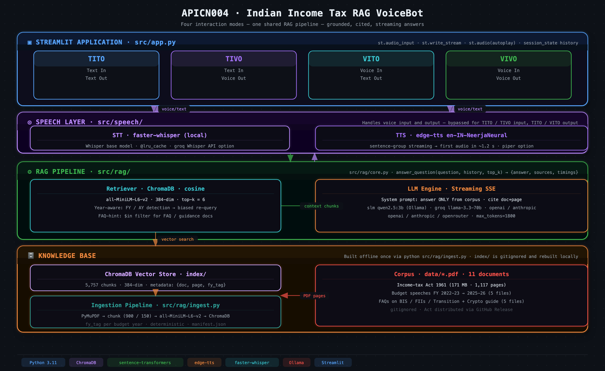

<div align="center">

# 🧾 APICN004 — Indian Income Tax RAG VoiceBot

**Ask India's income-tax law in text or voice — get grounded, cited answers from one shared RAG pipeline.**


</div>

A Retrieval-Augmented Generation (RAG) assistant that answers **Indian Income Tax** questions
from a corpus of official government PDFs — the **Income-tax Act 1961**, **Union Budget
speeches**, and **government FAQs**. Every answer is **grounded** in the retrieved corpus and
**cited** down to the source document and page, and the whole stack is **open-source and
offline by default**.

One pipeline (`src/rag/core.py`) powers **four interaction modes** — the only difference is how
the question comes in and how the answer goes out:

<div align="center">

| | Input | Output | Pipeline |
|:--:|:--:|:--:|:--:|
| **TITO** | ⌨️ Typed text | 📄 Printed text | *(shared)* |
| **TIVO** | ⌨️ Typed text | 🔊 Spoken voice | *(shared)* |
| **VITO** | 🎙️ Spoken voice | 📄 Printed text | *(shared)* |
| **VIVO** | 🎙️ Spoken voice | 🔊 Spoken voice | *(shared)* |

</div>

---

## 📑 Table of Contents

- [Demo Video](#-demo-video)
- [Highlights](#-highlights)
- [Architecture](#-architecture)
- [Project Structure](#-project-structure)
- [Team](#-team)
- [Prerequisites](#-prerequisites)
- [1. Clone the Repository](#1-clone-the-repository)
- [2. Set Up the Python Environment](#2-set-up-the-python-environment)
- [3. Configure Environment Variables](#3-configure-environment-variables)
- [4. Prepare the Income Tax Corpus](#4-prepare-the-income-tax-corpus)
- [5. Build the RAG Index](#5-build-the-rag-index)
- [6. Run the Chatbot](#6-run-the-chatbot)
- [7. Speech Configuration](#7-speech-configuration)
- [8. Tests & Evaluation](#8-tests--evaluation)
- [9. Latency & Optimisations](#9-latency--optimisations)
- [10. Troubleshooting](#10-troubleshooting)
- [Design Decisions](#-design-decisions)
- [Bonus Features](#-bonus-features)

---

## 🎥 Demo Video

<div align="center">

[](https://www.youtube.com/watch?v=Hhy43n-bA6k)

▶️ **[Watch the full walkthrough on YouTube](https://www.youtube.com/watch?v=Hhy43n-bA6k)** — all four modes, end to end.

</div>

Jump straight to any mode (links open the video at that timestamp):

| Mode | What it shows | Timestamp |
|------|---------------|-----------|
| **TITO** — type → read | Typed question, printed grounded answer with citations | [▶ 0:00](https://youtu.be/Hhy43n-bA6k?t=0) – 0:55 |
| **TIVO** — type → hear | Typed question, spoken answer via TTS | [▶ 0:56](https://youtu.be/Hhy43n-bA6k?t=56) – 4:46 |
| **VITO** — speak → read | Spoken question (mic → STT), printed answer | [▶ 4:47](https://youtu.be/Hhy43n-bA6k?t=287) – 5:53 |
| **VIVO** — speak → hear | Spoken question, spoken answer (with a multi-turn follow-up) | [▶ 5:54](https://youtu.be/Hhy43n-bA6k?t=354) – 8:09 |

---

## ✨ Highlights

- 🔁 **One pipeline, four modes.** TITO / TIVO / VITO / VIVO all call the same
  `answer_question()` — no mode has its own RAG path, so behaviour stays consistent.
- 🔒 **Grounded & cited.** A strict system prompt forbids outside knowledge; citations come
  from retriever **metadata** (`doc`, `page`), so they cannot be hallucinated.
- 📅 **Year-aware retrieval.** The retriever detects an FY/AY in the question and re-queries
  with a year filter, so FY-specific slab questions draw from the correct budget.
- 🧾 **FAQ-aware retrieval.** Questions mentioning FIIs/BIS/transition/crypto are biased
  toward the relevant FAQ documents so they aren't buried under the 1,117-page Act.
- 💬 **Multi-step follow-ups.** "What about the old regime?" expands the search with prior
  turns, so pronouns and references resolve across the conversation.
- 🗣️ **Natural speech.** Markdown, LaTeX, and symbols are cleaned before TTS, and subtraction
  is spoken as "minus" — no "asterisk asterisk" or run-together numbers.
- ⚡ **Streaming everywhere.** Tokens render as they arrive and audio starts after the first
  sentence group — perceived latency is a fraction of full-answer time.
- 🧱 **Reproducible ingestion.** Deterministic chunking + an `index/manifest.json` recording
  the model, dimensions, chunk params, and per-document counts.
- 🔌 **Swappable providers.** `slm` (Ollama) · `groq` · `openai` · `anthropic` · `openrouter`
  for the LLM; `local`/`groq`/`openai` for STT; `edge`/`piper` for TTS.

---

## 🏗 Architecture



The modes differ only in how the question enters (typed vs microphone) and how the answer
leaves (text vs speech); the RAG core is identical for all four. See
[`report/architecture.md`](report/architecture.md) for the request-flow diagram and a
module-by-module breakdown.

<details><summary>Text diagram (ASCII fallback)</summary>

```
            ┌──────────────── Streamlit UI (src/app.py) ────────────────┐
            │  text box   │   🎙 st.audio_input → STT (faster-whisper)    │
            └──────┬──────────────────────┬──────────────────────────────┘
                   │  question (text)      │
                   ▼                       ▼
        ┌───────────────── src/rag/core.answer_question ─────────────────┐
        │  Retriever (ChromaDB, cosine) ── top-k chunks + doc/page/FY     │
        │        │  sentence-transformers all-MiniLM-L6-v2 embeddings      │
        │        ▼                                                         │
        │  grounded prompt → LLM (slm/groq/openai/anthropic/            │
        │                         openrouter), streamed + citations      │
        └───────────────┬──────────────────────────────┬─────────────────┘
                        │ answer text + citations        │
                        ▼                                 ▼
                   display text                   TTS (edge-tts) → audio
```

</details>

---

## 📂 Project Structure

```
APICN004/
├── src/
│   ├── app.py                 # Streamlit UI wiring the four modes around core
│   ├── config.py              # Env/config accessors (paths, models, chunking, top-k)
│   ├── rag/
│   │   ├── ingest.py          # PDF → page-anchored chunks → embeddings → ChromaDB + manifest
│   │   ├── embed.py           # Cached sentence-transformers model (L2-normalised)
│   │   ├── retriever.py       # ChromaDB top-k + FY/AY year-biasing + FAQ-hint biasing
│   │   ├── llm.py             # Provider switch, grounding prompt, SSE streaming
│   │   └── core.py            # THE shared pipeline: retrieve → context → generate → cite
│   ├── speech/
│   │   ├── stt.py             # Audio → text (faster-whisper | Groq | OpenAI)
│   │   └── tts.py             # Text → audio (edge-tts | piper), speech-cleaned + streaming
│   └── ui/components.py       # Mode map, source formatting, LaTeX→text, history helpers
├── tests/                     # 41 offline unit tests + run_eval.py (13-question harness)
├── report/                    # architecture · limitations · test_results · latency_results
├── demo/                      # 8 VIVO demo recordings (vivo_0..7.mp3)
├── data/                      # corpus PDFs (gitignored; Act via GitHub Release)
├── index/                     # persistent ChromaDB store + manifest.json (gitignored)
├── .env.example               # configuration template
├── requirements.txt
└── README.md
```

---

## 👥 Team

| Member | ID | Email | Role |
|--------|----|-------|------|
| Nilay Shekhar | 2023SL70011 | 2023sl70011@wilp.bits-pilani.ac.in | RAG pipeline (ingestion, retrieval, year-aware biasing), LLM integration |
| Prerana Maktal | 2023SL70016 | 2023sl70016@wilp.bits-pilani.ac.in | Speech modules (STT / TTS), Streamlit UI & four interaction modes |
| Pravalika Bachu | 2023SL70017 | 2023sl70017@wilp.bits-pilani.ac.in | Evaluation harness, latency measurements, documentation |

---

## ✅ Prerequisites

| Requirement | Notes |
|-------------|-------|
| **Python 3.11** | The ML/audio stack (`torch`, `chromadb`, `faster-whisper`, `ctranslate2`) lacks wheels for 3.12+/3.14. Union type syntax (`str \| None`) also requires ≥ 3.10. |
| **Git** | To clone the repository. |
| **Embeddings** | **No Ollama needed for embeddings.** They run locally and offline via `sentence-transformers/all-MiniLM-L6-v2` (384-dim), downloaded once from Hugging Face then cached. |
| **An LLM backend** | Ollama (`slm`, fully offline, open-source — the default), or a cloud key (`groq` / `openai` / `anthropic` / `openrouter`). See [§3](#3-configure-environment-variables). |
| **Microphone** | Required for VITO and VIVO modes only (Streamlit requests browser mic permission). |
| **Audio output** | Required for TIVO and VIVO modes only (browser plays the synthesized answer). |
| **Network** | `edge-tts` uses Microsoft's online voices; `faster-whisper` downloads its model on first run. A fully-offline run uses `slm` + `local` STT + `piper` TTS. |

---

## 1. Clone the Repository

```bash
git clone https://github.com/BITSSAP2025AugAPIBP3Sections/APICN004.git
cd APICN004
```

All subsequent commands must be run from this repository root.

---

## 2. Set Up the Python Environment

**macOS / Linux:**
```bash
python3.11 -m venv .venv
source .venv/bin/activate
python -m pip install --upgrade pip
pip install -r requirements.txt
```

**Windows:**
```bat
py -3.11 -m venv .venv
.venv\Scripts\activate
python -m pip install --upgrade pip
pip install -r requirements.txt
```

---

## 3. Configure Environment Variables

Copy the template and edit it:

```bash
cp .env.example .env
```

### Core variables

| Variable | Default (code) | Description |
|----------|----------------|-------------|
| `LLM_PROVIDER` | `slm` | LLM backend: `slm` (Ollama, open-source) · `groq` · `openai` · `anthropic` · `openrouter` |
| `LLM_MODEL` | per-provider† | Model for the selected provider. Leave unset to use the provider's coded default. |
| `LLM_MAX_TOKENS` | `1800` | Max answer length. Raised from 900 so multi-step tax calculations don't truncate. |
| `LLM_TEMPERATURE` | `0.1` | Low temperature for deterministic, grounded answers. |
| `EMBED_MODEL` | `sentence-transformers/all-MiniLM-L6-v2` | Local embedding model (offline, 384-dim, L2-normalised). |
| `EMBED_BATCH` | `64` | Chunks per embedding batch during ingestion. |
| `INDEX_DIR` | `index` | Where the persistent ChromaDB store is written. |
| `DATA_DIR` | `data` | Where corpus PDFs are read from. |
| `COLLECTION` | `income_tax` | ChromaDB collection name. |
| `TOP_K` | `6` | Corpus chunks retrieved per query. |
| `CHUNK_SIZE` | `900` | Characters per chunk during ingestion. |
| `CHUNK_OVERLAP` | `150` | Overlap between consecutive chunks. |
| `STT_PROVIDER` | `local` | STT backend: `local` (faster-whisper) · `groq` · `openai` |
| `STT_MODEL` | `base` | faster-whisper size (`tiny`/`base`/`small`/`medium`/`large-v3`) when `STT_PROVIDER=local`. |
| `TTS_PROVIDER` | `edge` | TTS backend: `edge` (edge-tts) · `piper` |
| `TTS_VOICE` | `en-IN-NeerjaNeural` | edge voice name, **or** a piper `.onnx` model path (required for piper). |
| `TTS_RATE` | `+0%` | edge speaking rate, e.g. `+10%` / `-10%`. |
| `SHOW_TIMING` | `0` | `1` prints a per-stage latency breakdown (embed / search / LLM / total). |

### Provider API keys (only the one you use)

| Variable | Needed when |
|----------|-------------|
| `GROQ_API_KEY` | `LLM_PROVIDER=groq` or `STT_PROVIDER=groq` |
| `OPENAI_API_KEY` | `LLM_PROVIDER=openai` or `STT_PROVIDER=openai` |
| `ANTHROPIC_API_KEY` | `LLM_PROVIDER=anthropic` |
| `OPENROUTER_API_KEY` | `LLM_PROVIDER=openrouter` |
| `SLM_BASE_URL` / `SLM_API_KEY` | `LLM_PROVIDER=slm` — Ollama's OpenAI-compatible endpoint (`http://localhost:11434/v1`, key `ollama`) |

† **`LLM_MODEL` coded defaults per provider** (used only when `LLM_MODEL` is unset):

| Provider | Coded default model |
|----------|---------------------|
| `slm` (Ollama) | `qwen2.5:3b` |
| `groq` | `llama-3.3-70b-versatile` |
| `openai` | `gpt-4o-mini` |
| `anthropic` | `claude-3-5-haiku-20241022` |
| `openrouter` | `meta-llama/llama-3.1-8b-instruct` |

### Example: fully-offline local Ollama (default, open-source)

```env
LLM_PROVIDER=slm
LLM_MODEL=qwen2.5:3b
SLM_BASE_URL=http://localhost:11434/v1
SLM_API_KEY=ollama
STT_PROVIDER=local
TTS_PROVIDER=edge
```

Then install and warm Ollama:

```bash
# install from https://ollama.com (or `brew install ollama` on macOS)
ollama serve                 # if not already running
ollama pull qwen2.5:3b
```

### Example: Groq cloud (faster, open-weight models)

```env
LLM_PROVIDER=groq
LLM_MODEL=llama-3.3-70b-versatile
GROQ_API_KEY=<your-groq-api-key>
STT_PROVIDER=local
TTS_PROVIDER=edge
```

> **Fully open-source by default.** The default stack is entirely open-source and offline:
> the SLM runs on Ollama (`qwen2.5:3b`, Apache-2.0), embeddings use the local
> `all-MiniLM-L6-v2`, STT uses faster-whisper, and TTS uses edge-tts. The LLM backend is
> swappable at any time via `LLM_PROVIDER` if you prefer a cloud key.

---

## 4. Prepare the Income Tax Corpus

The `data/` directory holds the corpus PDFs (gitignored). The full corpus is **11 documents**:

| Document(s) | Source | Notes |
|-------------|--------|-------|
| `Income-tax-Act-1961_2026_..._en.pdf` | Income-tax Act 1961 | ~171 MB, 1,117 pages — exceeds GitHub's file limit, distributed as a **Release asset** |
| `bs202223.pdf` · `bs2023_24.pdf` · `bs2024_25(I).pdf` · `bs2024_25.pdf` · `bs2025_26.pdf` | Union Budget speeches | FY 2022-23 → 2025-26, FY-tagged during ingestion |
| `FAQs-on-BIS-Exemption.pdf` · `FAQs-on-FIIs-Exemption.pdf` · `FAQs-on-Transition-Provisions.pdf` · `Updated-FQAs-on-Interplay&Transitions.pdf` | Government FAQs | — |
| `E-Book-Guidance-Note-Crypto-Asset-Reporting-Obligations.pdf` | Crypto / VDA guidance | — |

**Steps for the large Act PDF:**
1. Open the repository's **Releases** page.
2. Download the asset with the exact filename above.
3. Place it in `data/` — **the filename must match exactly**.

> Ingestion runs with whatever PDFs are present and prints a `stderr` warning for any missing
> expected file (it does **not** abort). The full corpus is needed for the complete official
> test bank — Sections 80C, 112A, 115BBH, 194S, 206C, FII/BIS exemptions, and
> residential-status questions.

---

## 5. Build the RAG Index

```bash
python src/rag/ingest.py
```

This reads every `data/*.pdf`, extracts page-anchored text with PyMuPDF, chunks it
deterministically (word-boundary, `CHUNK_SIZE`/`CHUNK_OVERLAP`), embeds with the local
sentence-transformers model, and writes:

- a persistent **ChromaDB** collection under `index/` (cosine similarity, metadata
  `{doc, page, fy_tag}`), and
- `index/manifest.json` recording the embedding model, dimensions, chunk params, and
  per-document chunk counts (reproducible-ingestion record).

Re-run this whenever the corpus changes. The full corpus produces **5,757 chunks across 11
documents** (384-dim embeddings).

---

## 6. Run the Chatbot

The interface is a **Streamlit** web app. Launch it and pick a mode in the sidebar:

```bash
streamlit run src/app.py
```

Open the URL it prints (default `http://localhost:8501`). In the sidebar you can choose the
interaction mode (**TITO / TIVO / VITO / VIVO**), see the index chunk count, and clear the
conversation.

- **Text input modes (TITO / TIVO):** type at the chat box.
- **Voice input modes (VITO / VIVO):** record with the mic; the audio is transcribed and
  treated exactly like a typed question. The recorder **resets after each turn** so you can
  ask questions back-to-back without refreshing.
- **Voice output modes (TIVO / VIVO):** the answer is synthesized and autoplays in the browser.
- Conversation history persists in the session, so **multi-step follow-ups** keep context.

> The first query of a session takes a few seconds longer while the embedding model loads;
> it is cached and warm for every query after.

### Command-line interface (no UI)

The same four modes are available headlessly via `python src/app.py` — useful for scripting
and automated evaluation:

```bash
python src/app.py --mode tito --question "What is the Section 80C deduction limit?"
python src/app.py --mode tivo --question "New regime slab rates for FY 2024-25?"   # also speaks
python src/app.py --mode tito                                                      # interactive loop
```

A minimal one-shot is also exposed directly on the pipeline:

```bash
python src/rag/core.py "What is the Section 80C deduction limit?"
```

Both print the grounded answer, its sources, and the timing breakdown.

### Retrieval sanity check

```bash
python src/rag/retriever.py
```

Prints the chunk count and the top hits (doc/page/FY tags) for a sample query.

---

## 7. Speech Configuration

### STT (Speech-to-Text)

| Provider | `STT_PROVIDER` | Requirements |
|----------|----------------|--------------|
| faster-whisper (offline) | `local` | `STT_MODEL=base` (or `tiny`/`small`/`medium`/`large-v3`); model cached after first use, no API key |
| Groq Whisper | `groq` | `GROQ_API_KEY`; uses `whisper-large-v3-turbo` |
| OpenAI Whisper | `openai` | `OPENAI_API_KEY`; uses `whisper-1` |

The API paths retry once on a 429/5xx or network error before failing.

### TTS (Text-to-Speech)

| Provider | `TTS_PROVIDER` | Requirements |
|----------|----------------|--------------|
| Edge TTS (default) | `edge` | Network access; default voice `en-IN-NeerjaNeural`, override with `TTS_VOICE`, rate with `TTS_RATE` |
| Piper (offline) | `piper` | `piper` binary on PATH; `TTS_VOICE` must point to a `.onnx` model file |

Answers are synthesized in ~2-sentence groups so audio starts before the whole answer is
rendered, and markdown/LaTeX/symbols are cleaned so the voice reads clean prose.

---

## 8. Tests & Evaluation

Unit tests are fully offline (network mocked) — **41 tests across 6 modules**:

```bash
python -m pytest tests/ -q
```

Run the 13 official questions through the shared TITO pipeline and regenerate the results:

```bash
python tests/run_eval.py          # writes report/test_results.md
```

The evaluation harness covers **5 Easy + 5 Medium + 3 Complex** questions spanning slab rates,
Section 80C, standard deduction, LTCG/STCG, LRS/TCS, VDA (115BBH/194S), FII/BIS exemptions, and
residential status — each answered with grounded text and `doc p.page` citations, written to
[`report/test_results.md`](report/test_results.md). Full reports live in [`report/`](report/):
`architecture.md`, `limitations.md`, `test_results.md`, `latency_results.md`.

---

## 9. Latency & Optimisations

Measured on Apple M3 Pro (36 GB), open-source SLM `qwen2.5:3b`, warm caches, mean of 3 runs
(full numbers in [`report/latency_results.md`](report/latency_results.md)):

| Stage | Easy | Medium | Complex |
|-------|-----:|-------:|--------:|
| Query embedding (ms) | 34 | 39 | 51 |
| Retrieval (ms) | 1 | 6 | 1 |
| LLM full answer (ms) | 2,155 | 7,656 | 27,527 |

**Optimisations applied:** ① streaming LLM output (first tokens in ~1–2 s vs. up to 27 s for a
full complex answer), ② sentence-group streaming TTS (first audio in ~1.2 s), ③ warm model
caches (embedding ≈ 40 ms vs. ~8 s cold), ④ `max_tokens` tuned to 1,800 so long calculations
don't truncate.

---

## 10. Troubleshooting

**LLM provider key missing**
```
LLM_PROVIDER=groq requires GROQ_API_KEY ...
```
Set the appropriate key in `.env` for the chosen provider (see [§3](#3-configure-environment-variables)).

**Ollama not running (only if `LLM_PROVIDER=slm`)**
```
Connection refused … http://localhost:11434
```
Start it with `ollama serve` and pull the model: `ollama pull qwen2.5:3b`.

**Missing or stale index**
```
Index not found at index/. Run `python src/rag/ingest.py` first.
```
Build it with `python src/rag/ingest.py`; re-run after any corpus change.

**Missing corpus files**
Ingestion warns on `stderr` for each missing expected PDF but still builds an index from
whatever is present. Download the large Income-tax Act PDF from Releases and place it in
`data/` with the exact filename for complete coverage.

**Embedding model download blocked**
The first run downloads `all-MiniLM-L6-v2` from Hugging Face. On a restricted network,
pre-download it or set `HF_HOME` to a cache that already contains it.

**Microphone permission denied / no audio (VITO / VIVO)**
Grant the browser microphone access when Streamlit prompts. For voice output, confirm system
volume and that the tab isn't muted. For a fully-offline TTS path, use `TTS_PROVIDER=piper`.

**First query is slow**
Expected — the embedding model cold-loads once per process. Subsequent queries are warm
(embedding ≈ 40 ms).

---

## 🧠 Design Decisions

- **One pipeline, four modes.** `core.answer_question()` / `core.stream_answer()` is the only
  RAG path. The UI picks input (text box vs `st.audio_input` → STT) and output (text vs TTS)
  *around* that single call — modes never diverge in retrieval or generation.
- **Citations from metadata, not model text.** Sources shown in the UI come from the
  retriever's `{doc, page}` metadata, so they are impossible to hallucinate even if the model
  misformats an inline citation.
- **Year-sensitivity is explicit.** Budget-speech chunks are tagged with their financial year;
  a question naming an FY/AY triggers a second year-filtered query whose hits are prepended, so
  FY-2024-25 slab questions don't mix in older-budget provisions.
- **Deterministic, reproducible ingestion.** Word-boundary chunking with no randomness yields
  identical chunks for identical input, and `manifest.json` records exactly how the index was
  built.
- **Speech ≠ screen.** The on-screen answer keeps full markdown; the spoken answer is cleaned
  (markdown/LaTeX stripped, symbols spoken, subtraction voiced as "minus", line breaks become
  pauses) so audio sounds natural.

---

## 🏆 Bonus Features

- **Streaming TTS** — audio starts after the first sentence group, not the whole answer.
- **Multi-turn VIVO** — prior turns are carried into the prompt *and* the retrieval query, so
  spoken follow-ups keep context.
- **Reproducible ingestion** — deterministic chunking + `index/manifest.json`.
- **Six swappable providers** across LLM / STT / TTS, selected entirely via `.env`.
- **Year-aware + FAQ-aware retrieval** on top of plain vector search.

---

<div align="center">

*Built for the APICN004 assignment · Indian Income Tax RAG VoiceBot · fully open-source stack*

</div>
