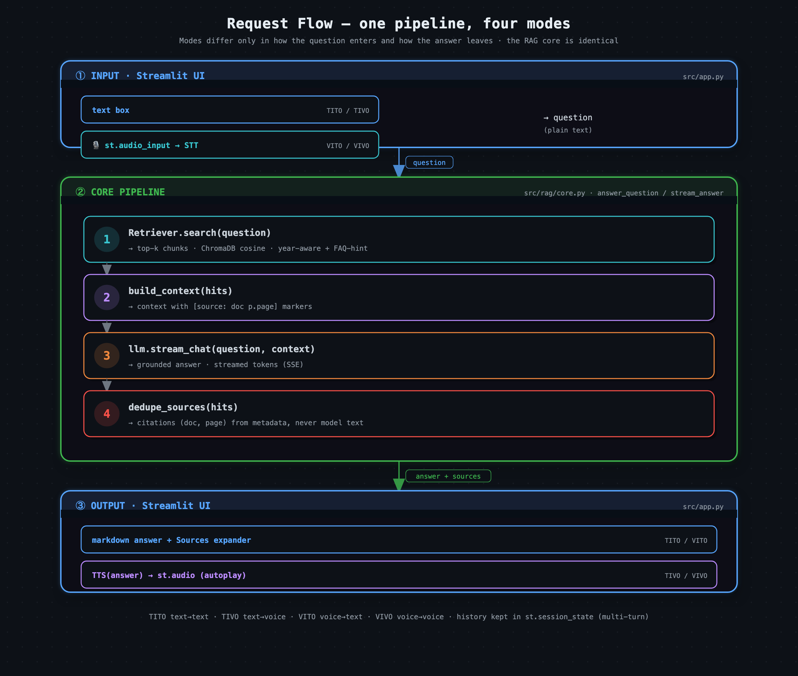

# Architecture — APICN004

## Overview

APICN004 is a Retrieval-Augmented Generation (RAG) assistant over the Indian Income-Tax
corpus. A **single pipeline** (`src/rag/core.py`) serves all four interaction modes; the
modes differ only in how the question enters (typed vs microphone) and how the answer
leaves (text vs speech).



<details><summary>Text diagram</summary>

```
Streamlit UI (src/app.py)
  ├─ input:  text box            ─┐
  │          st.audio_input ─ STT ┤→ question (plain text)
  │                               │
  ▼                               ▼
src/rag/core.answer_question / stream_answer
  1. Retriever.search(question)           → top-k chunks (ChromaDB, cosine)
  2. build_context(hits)                  → context with [source: doc p.page] markers
  3. llm.stream_chat(question, context)   → grounded answer (streamed tokens)
  4. dedupe_sources(hits)                 → citations (doc, page)
  ▼
Streamlit UI
  ├─ output: markdown answer + Sources expander
  └─ output: TTS(answer) → st.audio (TIVO/VIVO)
```

</details>

## Modules

| File | Responsibility |
|------|----------------|
| `src/config.py` | Environment/config accessors (paths, models, chunking, top-k). |
| `src/rag/embed.py` | Cached sentence-transformers model; `embed_texts` / `embed_query` (L2-normalised). |
| `src/rag/ingest.py` | PDF → page-anchored chunks → embeddings → ChromaDB + `manifest.json`. |
| `src/rag/retriever.py` | ChromaDB top-k retrieval; FY/AY detection + year-biased re-ranking. |
| `src/rag/llm.py` | Provider switch (slm/groq/openai/anthropic/openrouter); streaming; grounding prompt. |
| `src/rag/core.py` | The shared pipeline: retrieve → context → generate → cite. Used by UI + eval. |
| `src/speech/stt.py` | Audio (path or bytes) → text (faster-whisper / Groq / OpenAI). |
| `src/speech/tts.py` | Text → audio bytes (edge-tts / piper); sentence-group streaming. |
| `src/app.py` | Streamlit UI wiring the four modes around `core`. |
| `src/ui/components.py` | Mode map, source formatting, LLM-history conversion. |

## Ingestion

1. **Extract** — PyMuPDF yields text per page (1-indexed), so page numbers survive to citations.
2. **Chunk** — deterministic word-boundary chunking (~900 chars, 150 overlap). No randomness,
   so the same corpus always yields the same chunks (reproducible-ingestion bonus).
3. **Tag** — budget-speech filenames (`bs2024_25.pdf`) are tagged with their financial year
   (`FY2024-25`); other documents are tagged `general`.
4. **Embed** — `all-MiniLM-L6-v2`, L2-normalised, batched.
5. **Store** — a fresh ChromaDB persistent collection (`hnsw:space=cosine`) with
   `{doc, page, fy_tag}` metadata, plus `index/manifest.json` recording the build.

## Retrieval & grounding

- The query is embedded with the *same* model and searched by cosine similarity.
- **Year sensitivity:** if the question names an FY (or an AY, mapped back one year), the
  retriever runs a second year-filtered query and prepends those hits, so FY-specific slab
  questions draw from the correct budget rather than mixing years. This directly addresses the
  assignment's warning about blindly combining provisions across years.
- The LLM receives a strict system prompt: answer only from context, explicitly say when the
  corpus lacks the answer, state the applicable FY/AY, show calculation steps, and cite
  `doc p.page`. Citations shown in the UI come from retriever **metadata**, not model text, so
  they cannot be hallucinated.

## Four modes, one pipeline

`core.stream_answer()` returns `(sources, token_generator)`: the UI shows citations immediately
and streams the answer beneath them. For voice output, the completed answer is synthesised by
`tts` and played via `st.audio`. Conversation history is kept in `st.session_state` and the last
few turns are passed back into the prompt (multi-turn VIVO).

## Provider flexibility

`llm.resolve()` reads `LLM_PROVIDER`/`LLM_MODEL` at call time. `slm`, `groq`, `openai`, and
`openrouter` share the OpenAI chat-completions streaming format; `anthropic` uses the Messages
API. The default is the offline SLM (Ollama); Groq is used in development for speed.
